# KURCF-Repro

**Variance-weighted K-means + co-rating collaborative filtering | Independent paper reproduction**

**English** | [简体中文](README.zh-CN.md) · [Original paper](https://doi.org/10.1038/s41598-025-96705-0) · [Raw benchmark JSON](benchmarks/) · [Methodology audit](docs/reproduction-notes.md)

> [!IMPORTANT]
> This is an **independent implementation**, not the authors' official source code. The two MovieLens experiments below are **real GitHub Actions smoke runs with small evaluation samples**, not the original paper's experimental partitions. The published performance improvements have **not** been independently established.

## 1. Research overview

This project studies **KUR-CF**, a user-based collaborative filtering method that combines (i) user–attribute scores, (ii) variance-weighted K-means user clustering, and (iii) a Pearson–Jaccard co-rating similarity. The goal is to reduce the neighborhood search space and model both rating agreement and overlap in rated items.

**Reference:** ShengShai Zhang, Shiping Chen, Xiaodong Yu and Shaowei Mei. *Research on collaborative filtering algorithm based on improved K-means algorithm for user attribute rating and co-rating*. **Scientific Reports**, 15, 19600 (2025). [DOI: 10.1038/s41598-025-96705-0](https://doi.org/10.1038/s41598-025-96705-0).

*Figure 1. Reconstructed implementation pipeline. Green boxes correspond to paper-described computations; the orange rating-prediction box is a documented reproduction choice, because the paper does not supply its complete prediction equation.*

### What is implemented?

| Component | Source | Implementation |
|:--|:--|:--|
| User–attribute rating matrix | Paper Eq. (3) | `src/kurcf/core.py`: `KURCF.fit` |
| Attribute variance and normalized weights | Paper Eqs. (4)–(5) | `variance_weights` |
| Weighted K-means and projected centers | Paper Eqs. (6)–(7) | `weighted_kmeans` |
| Silhouette / cluster-count exploration | Paper Eq. (8) | `kurcf sweep-k`; see methodological difference below |
| Co-rated item Jaccard similarity | Paper Eq. (9) | `jaccard_similarity` |
| Pearson–Jaccard mixture | Paper Eq. (10) | `combined_similarity` |
| Neighbor-based prediction and ranking | Paper describes the procedure, not an exact equation | `KURCF.neighbors`, `predict`, `recommend` |
| MAE, RMSE, Precision@K, Recall@K | Paper Eqs. (11)–(14) | `src/kurcf/evaluation.py` |

## 2. Mathematical formulation

**Mobile-friendly equations.** All mathematical expressions below are stored as SVG images, rendered from [editable LaTeX source](assets/equations/formulas.json) using [MathJax](scripts/render_equations.cjs). This avoids raw LaTeX in some GitHub mobile clients. Formula SVGs are XML-validated in CI, including nested radical graphics (the Eq. 6 fix in v0.1.4).

### 2.1 User–attribute rating matrix — Eq. (3)

Let m be the number of users, p the number of movies, and d the number of movie attributes (genre indicators in this implementation). Define the **training-only** user–movie rating matrix `X` (m × p) and the movie–attribute matrix `Y` (p × d, binary). Missing ratings contribute zero to this matrix product.

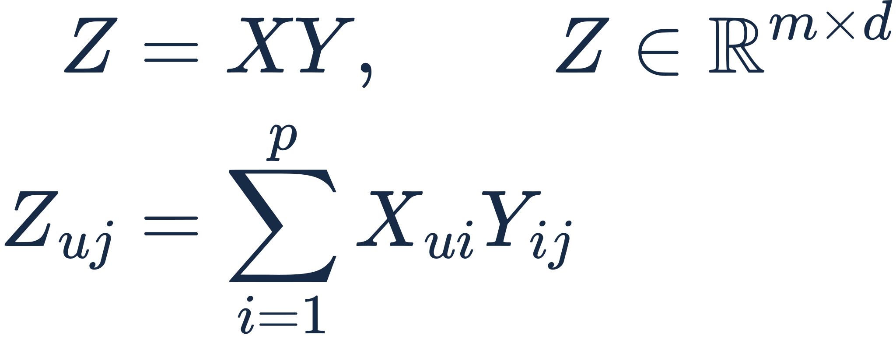

*Eq. (3) — user–attribute rating matrix.*

`Z[u,j]` aggregates the ratings user u assigned to movies having attribute j. It is a **sum**, not a normalized mean: prolific users can therefore have larger profile magnitudes. The code follows this paper-described construction.

### 2.2 Variance-based feature weighting — Eqs. (4)–(5)

For attribute j, the implementation uses the population variance across the m training users:

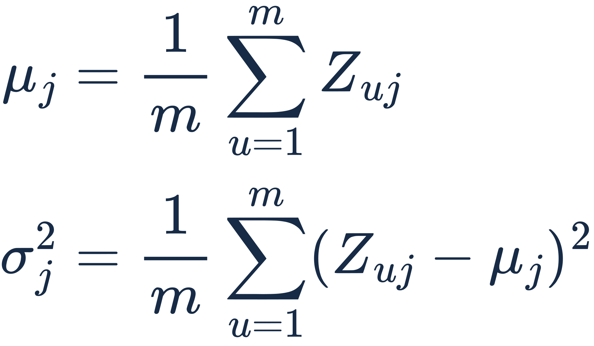

*Eq. (4) — attribute variance.*

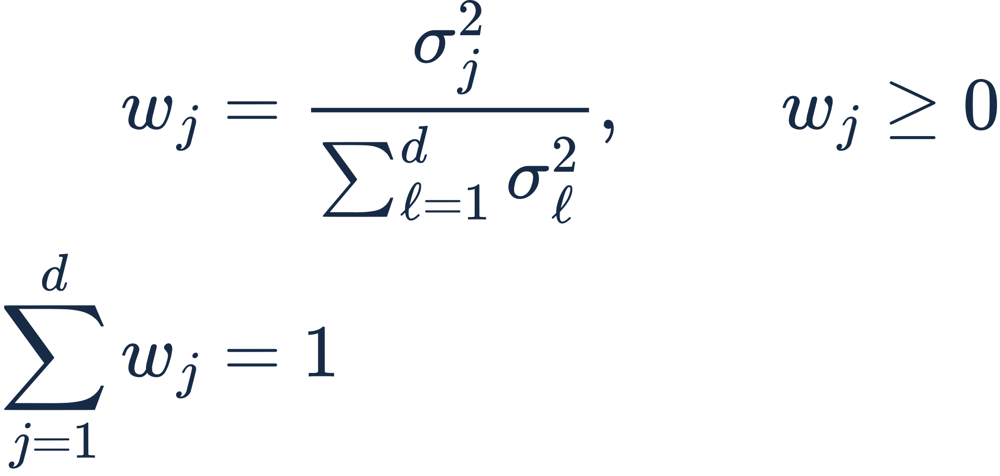

*Eq. (5) — normalized variance weights.*

A feature with higher variance receives greater weight. If all feature variances are zero, the code falls back to `w[j] = 1/d`; that fallback is an **engineering safeguard**, not an additional claim in the paper.

### 2.3 Weighted K-means clustering — Eqs. (6)–(8)

Users are clustered in attribute-profile space with the variance-weighted Euclidean distance

*Eq. (6) — weighted Euclidean distance.*

Squared distances are used in the implementation when only the nearest center is required; this does not change the assignments. For a cluster `C[k]`, first compute its mean and then project to the nearest **observed member** when projected centers are enabled:

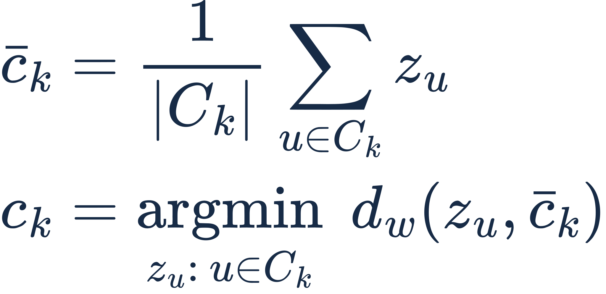

*Eq. (7) — centroid selection convention.*

The paper describes using the closest actual point to the cluster mean. This reproduction uses seeded farthest-first initialization and deterministic tie-breaking; the precise original initialization rule is not available. The paper also introduces a silhouette-style score,

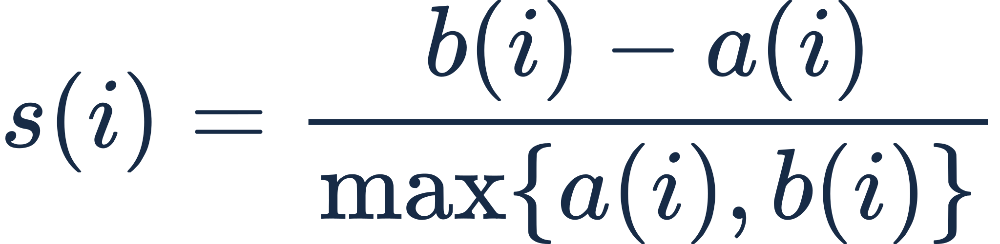

*Eq. (8) — silhouette coefficient.*

**Important:** `kurcf sweep-k` uses the *standard sample-based silhouette* in variance-scaled space; the paper's prose describes distances to cluster centers. The two should not be presented as identical computations.

### 2.4 Co-rating similarity — Eqs. (9)–(10)

Let `I[u]` and `I[v]` be the sets of items rated by users u and v, and let `I[uv] = I[u] ∩ I[v]`. The overlap term is

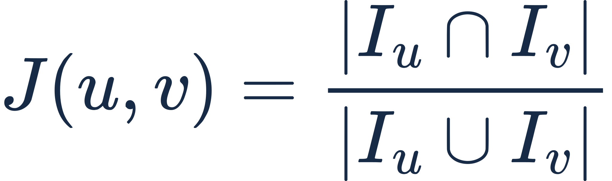

*Eq. (9) — Jaccard similarity.*

Pearson correlation `P(u,v)` is computed on their **co-rated** items:

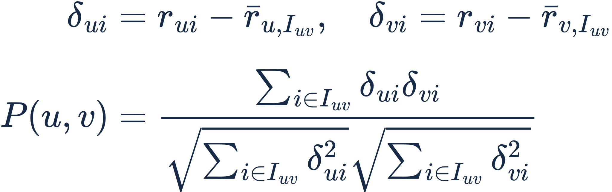

*Pearson correlation over co-rated items.*

The mixed similarity is

*Eq. (10) — hybrid similarity.*

If there are fewer than two co-rated items or either co-rated rating vector has zero variance, Pearson is set to zero. Candidate neighbors are restricted to the **same K-means cluster**; only positive mixed similarities are retained. Note that **Eq. (10) contains no explicit cluster-distance term**: clustering restricts the candidate set, rather than entering this formula as another summand.

### 2.5 Neighbor selection and rating prediction — implementation convention

The top N most similar eligible users are chosen within the target user's cluster (`N = 20` in the reported smoke runs). For target item i, only selected neighbors who rated i contribute to the prediction:

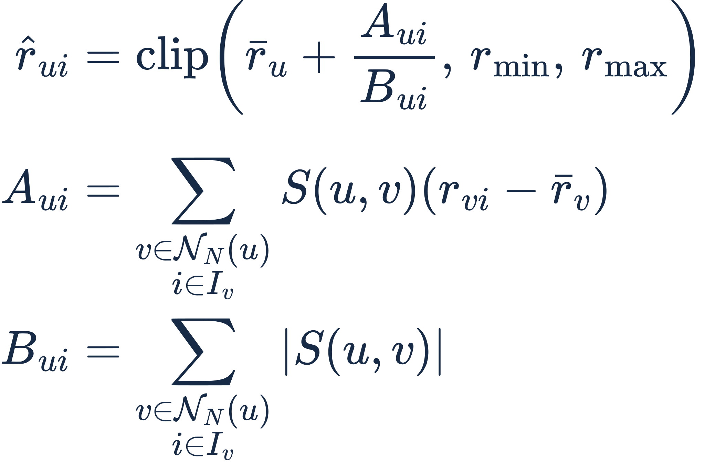

*Implementation convention — mean-centered rating prediction.*

The user and neighbor means in this equation are computed from **training interactions**. When the denominator is zero, prediction falls back to the training-set item mean, or the global training mean for an unseen item. These choices make the implementation executable, but **the paper does not specify this exact prediction equation or fallback policy**.

For Top-K recommendation, all catalog items not rated by the target user in training are scored and ranked. This candidate-universe definition affects Precision/Recall and may differ from the paper's unreleased evaluation protocol.

## 3. Datasets, baselines and evaluation

| Setting | MovieLens 100K | MovieLens 1M |
|:--|--:|--:|
| Original ratings | 100,000 | 1,000,209 |
| Training ratings | 80,000 | 800,193 |
| Held-out test ratings | 20,000 | 200,016 |
| K-means clusters | 7 | 6 |
| Random seed | 42 | 42 |
| Neighbors / mixture weight | 20 / 0.3 | 20 / 0.3 |
| Sampled rating cases for results below | **120** | **300** |
| Sampled users for Top-10 results below | **12** | **30** |

Data: [GroupLens MovieLens](https://grouplens.org/datasets/movielens/). The project downloads the datasets on demand and does not redistribute them. The **per-user randomized 80/20 split** is an independent reproducibility choice, not a reconstruction of the original authors' exact split.

The three implemented comparisons are **KUR-CF** (clustered, mixed similarity), **UserCF** (unclustered Pearson), and **Cluster-Pearson** (same clustering, Pearson-only ablation). These are **local, controlled baselines**; ItemCF and SVD from broader paper comparisons are not yet implemented.

The reported metrics are computed as follows, with q held-out rating cases and U evaluated users:

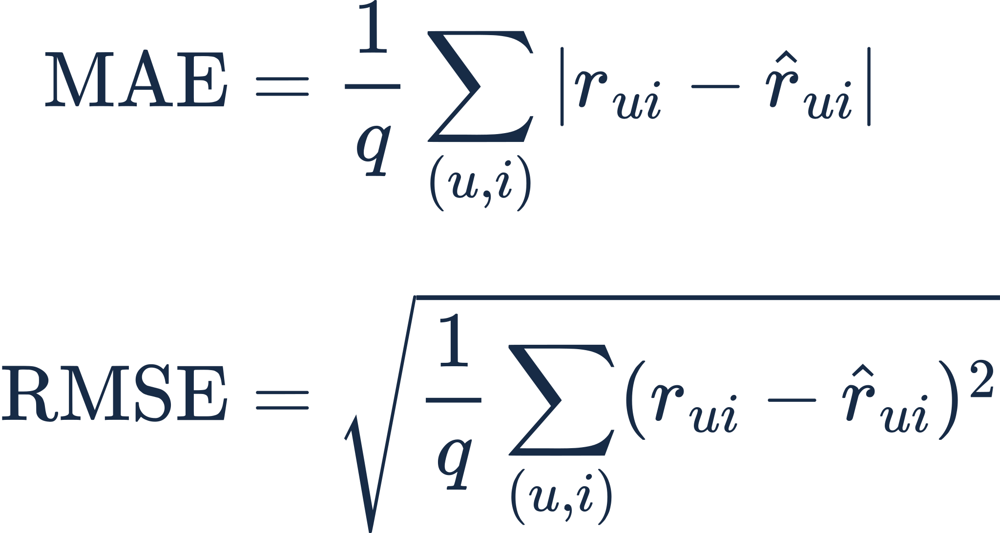

*Eqs. (11)–(12) — MAE and RMSE.*

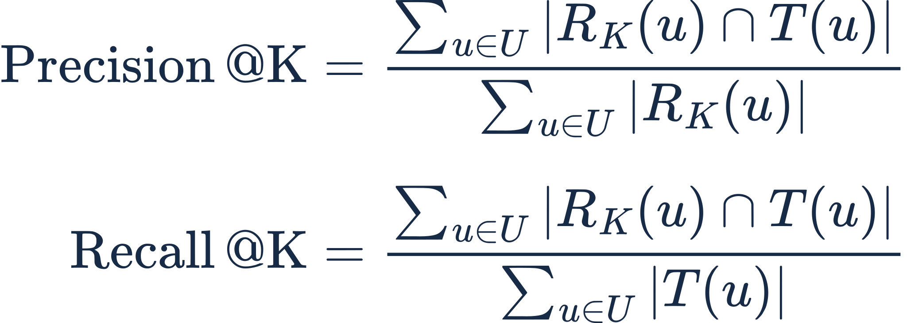

*Eqs. (13)–(14) — Precision@K and Recall@K.*

Here `R_K(u)` is the top-K recommendation list and `T(u)` consists of **held-out items rated at least 4**. Ranking metrics are micro-averaged over users having at least one relevant held-out item. Lower MAE/RMSE is better; higher Precision/Recall is better.

## 4. Observed reproduction results

These values were **actually generated by GitHub Actions** from the checked-in implementation and then preserved as JSON. Figures are produced from those JSON files by [`scripts/render_figures.mjs`](scripts/render_figures.mjs); they are **not traced or copied from the paper's plots**.

### 4.1 MovieLens 100K

| Method | MAE ↓ | RMSE ↓ | Precision@10 ↑ | Recall@10 ↑ |
|:--|--:|--:|--:|--:|
| **KUR-CF** | **0.86246** | **1.10465** | 0.00833 | 0.01075 |
| UserCF | 0.89891 | 1.15737 | 0.00833 | 0.01075 |
| Cluster-Pearson | 0.89838 | 1.16141 | **0.02500** | **0.03226** |

**Scope:** MAE/RMSE use 120 sampled test ratings; Top-10 uses 12 sampled users (1 / 1 / 3 hits respectively). [Raw JSON](benchmarks/ml100k-smoke.json) · [Successful Actions run](https://github.com/ZJY-HSBL/KURCF-Repro/actions/runs/38940035981).

### 4.2 MovieLens 1M

| Method | MAE ↓ | RMSE ↓ | Precision@10 ↑ | Recall@10 ↑ |
|:--|--:|--:|--:|--:|
| **KUR-CF** | **0.76263** | 0.97466 | 0.01667 | 0.00916 |
| UserCF | 0.77581 | **0.96391** | 0.01667 | 0.00916 |
| Cluster-Pearson | 0.77987 | 0.98706 | **0.02667** | **0.01465** |

**Scope:** MAE/RMSE use 300 sampled test ratings; Top-10 uses 30 sampled users (5 / 5 / 8 hits respectively). [Raw JSON](benchmarks/ml1m-smoke.json) · [Successful Actions run](https://github.com/ZJY-HSBL/KURCF-Repro/actions/runs/38940286685).

### 4.3 Interpretation and limitations

**Observed:** KUR-CF has the lowest *sampled MAE* on both datasets. It does **not** dominate the other methods: UserCF has the lowest 1M RMSE, and Cluster-Pearson has the highest sampled Precision@10 and Recall@10 in both experiments. Ranking conclusions are particularly unstable with only 12 or 30 evaluated users. No confidence intervals or statistical significance tests are available for these smoke runs.

**Not established:** The published article's performance-improvement percentages cannot be verified from these results. A strict numerical replication would require the authors' data preprocessing and test partitions, full prediction details, matched recommendation candidate sets, all reported baselines, repeated seeds, and uncertainty intervals. See [the audit](docs/reproduction-notes.md) and [full benchmark records](benchmarks/README.md).

## 5. Installation and reproduction

Python **3.10+**; only NumPy is required for the recommender. scikit-learn is used for the silhouette sweep.

~~~bash
git clone https://github.com/ZJY-HSBL/KURCF-Repro.git
cd KURCF-Repro
python -m pip install -e ".[dev]"
pytest -q
~~~

Download the original MovieLens data:

~~~bash
kurcf download --dataset ml-100k
kurcf download --dataset ml-1m
~~~

Run the three models with the **same small-sample settings** used for the committed figures:

~~~bash
kurcf benchmark --dataset ml-100k --seed 42 --clusters 7 \
  --neighbors 20 --alpha 0.3 --rating-cases 120 \
  --ranking-users 12 --top-k 10 --output results/ml100k-smoke.json

kurcf benchmark --dataset ml-1m --seed 42 --clusters 6 \
  --neighbors 20 --alpha 0.3 --rating-cases 300 \
  --ranking-users 30 --top-k 10 --output results/ml1m-smoke.json
~~~

For larger evaluations, increase `--rating-cases` and `--ranking-users`. The runtime can grow substantially, particularly for unclustered UserCF. The separate cluster-count study requires scikit-learn:

~~~bash
kurcf sweep-k --dataset ml-100k --min-k 4 --max-k 12 \
  --output results/silhouette.json
~~~

To regenerate **three benchmark SVGs** and **twelve math SVGs** from the checked-in JSON/LaTeX sources (requires Node.js 18+):

~~~bash
node scripts/render_figures.mjs
npm install --no-save --no-package-lock mathjax-full@3.2.2
node scripts/render_equations.cjs
git diff --exit-code -- assets/figures/ assets/equations/*.svg
~~~

The CI pipeline checks both benchmark-figure and equation-SVG reproducibility, as well as Python tests, before publishing a versioned GitHub Release. The checked-in figures visualize **the original recorded runs**; regenerating them does not silently replace benchmark measurements.

## 6. Project structure

~~~text
KURCF-Repro/
├── src/kurcf/
│   ├── core.py                 # weighted K-means, similarity, KUR-CF
│   ├── data.py                 # official MovieLens loaders, splits
│   ├── evaluation.py           # MAE/RMSE and ranking metrics
│   └── cli.py                  # download / benchmark / sweep-k
├── tests/test_kurcf.py        # unit and integration checks
├── tests/test_study.py        # ablation + aggregation validation
├── src/kurcf/study.py         # controlled full-rating protocol
├── scripts/summarize_study.py # paired multi-seed stats and SVG reports
├── benchmarks/
│   ├── ml100k-smoke.json      # verified 100K result
│   ├── ml1m-smoke.json        # verified 1M result
│   └── README.md              # experimental interpretation
├── assets/figures/            # vector pipeline + result charts
├── assets/equations/          # 12 equation SVGs + editable LaTeX JSON
├── scripts/render_figures.mjs # deterministic benchmark SVG generation
├── scripts/render_equations.cjs # MathJax equation SVG renderer
├── docs/reproduction-notes.md
├── README.zh-CN.md
└── .github/workflows/         # tests, releases, real-data smoke runs
~~~

## 7. Five-seed full-rating study and ablations (v0.2.1)

**Completed and archived:** MovieLens 100K, five independent user-stratified 80/20 splits (seeds 0–4). Every variant was evaluated on **all 20,000 held-out ratings per seed** (100,000 predictions across splits, not 100,000 distinct interactions). Top-10 recommendation metrics use **100 sampled eligible users per seed**, not the entire user population.

[Full report](benchmarks/study/README.md) · [Raw seed JSON](benchmarks/study/runs/) · [Means, SDs and 95% CIs](benchmarks/study/ml100k-summary.json) · [Successful GitHub Actions run](https://github.com/ZJY-HSBL/KURCF-Repro/actions/runs/39006215491) · [Study protocol](docs/study-protocol.md)

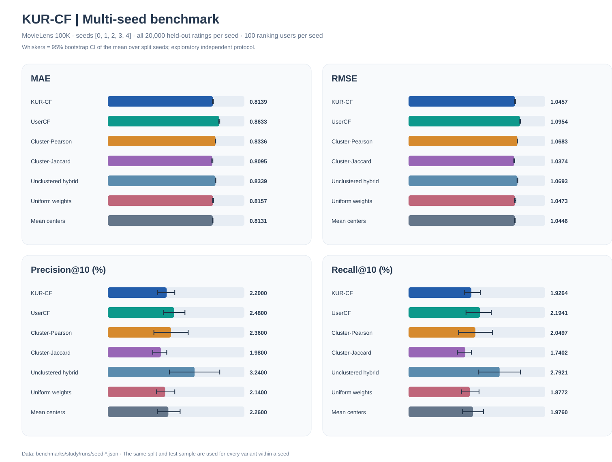

*Figure 4. Seven measured variants, with exploratory 95% bootstrap intervals over split seeds.*

| Variant | MAE ↓ | RMSE ↓ | Precision@10 ↑ | Recall@10 ↑ |
|:--|--:|--:|--:|--:|
| **KUR-CF (α=0.3)** | 0.8139 | 1.0457 | 2.20% | 1.93% |
| UserCF (Pearson) | 0.8633 | 1.0954 | 2.48% | 2.19% |
| Cluster-Pearson | 0.8336 | 1.0683 | 2.36% | 2.05% |
| **Cluster-Jaccard (α=0)** | **0.8095** | **1.0374** | 1.98% | 1.74% |
| **Unclustered hybrid** | 0.8339 | 1.0693 | **3.24%** | **2.79%** |
| Uniform feature weights | 0.8157 | 1.0473 | 2.14% | 1.88% |
| Unprojected mean centers | 0.8131 | 1.0446 | 2.26% | 1.98% |

**Interpretation.** KUR-CF improves mean MAE over unclustered Pearson UserCF by **0.0494** (paired baseline-minus-KUR-CF 95% bootstrap CI **[0.0456, 0.0535]**). However, pure **clustered Jaccard** has lower MAE and RMSE than KUR-CF at α=0.3. The **unclustered hybrid** has higher sampled Top-10 precision and recall. Removing variance weighting or projected centers changes MAE only slightly, with paired intervals spanning zero. **KUR-CF does not dominate all ablations.**

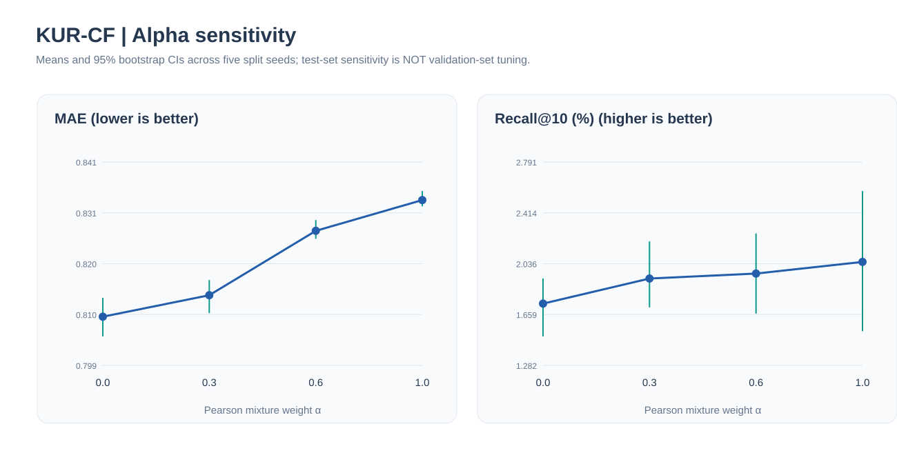

*Figure 5. Alpha sensitivity: α=0 gives the lowest MAE among the tested values, whereas larger α generally increases sampled recall. The test-set sweep is descriptive, **not** unbiased hyperparameter tuning.*

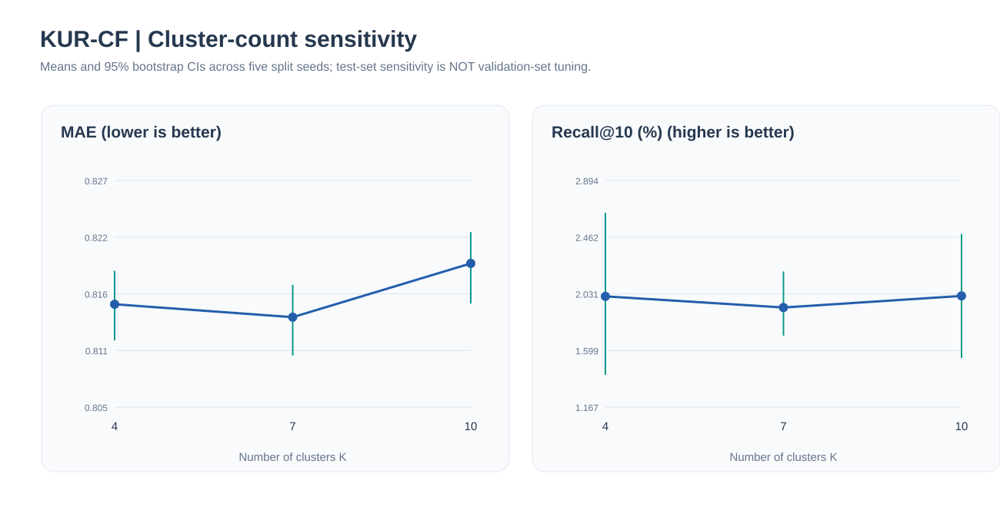

*Figure 6. K=4, 7, 10 sensitivity; this does not establish a universally optimal K.*

These results are stronger evidence for the independent 100K rating protocol than the earlier smoke sample, but **do not verify the original paper's numerical claims**. The authors' partitions and complete prediction rules remain unavailable; the ranking evaluation is still user-sampled.

Reproduce one seed and regenerate the committed report:

~~~bash
kurcf download --dataset ml-100k
kurcf study --dataset ml-100k --seed 0 --clusters 7 \
  --neighbors 20 --alpha 0.3 --rating-cases 0 \
  --ranking-users 100 --top-k 10 --output results/seed-0.json

python scripts/summarize_study.py --min-seeds 5 --check
~~~

## 8. Validation-only hyperparameter selection and full-user ranking (v0.3.0)

The v0.2.1 alpha/K sensitivity plots were measured on held-out test data, so they **cannot be used to select a winning model without test leakage**. The new v0.3.0 experiment addresses this with a **nested holdout**:

- Outer 80/20 user-stratified train/test split; an inner 80/20 split of outer training is used exclusively for tuning.
- Prespecified 12-point grid: K = 4, 7, 10; alpha = 0, 0.3, 0.6, 1.0. Select on **inner-validation MAE**, never outer-test MAE.
- Refit the selected model on outer training; evaluate all outer-test ratings and **all eligible ranking users**, not a 100-user sample.
- Compare fixed KUR-CF, selected KUR-CF, clustered Jaccard, unclustered hybrid and UserCF on matched outer-test populations.
- Five independent split seeds; preserve original JSON, selected parameters, paired metrics, bootstrap intervals and a generated SVG figure.

[Full protocol](docs/nested-protocol.md) · [Automated workflow](.github/workflows/movielens-nested.yml) · [Nested-study results, once workflow succeeds](benchmarks/nested/README.md)

~~~bash
kurcf download --dataset ml-100k
kurcf nested --dataset ml-100k --seed 0 --fixed-clusters 7 \
  --fixed-alpha 0.3 --alpha-grid 0 0.3 0.6 1.0 \
  --cluster-grid 4 7 10 --ranking-users 0 \
  --output results/nested-seed-0.json
~~~

**Status:** Code and automation are included in this release; do not infer any v0.3.0 numerical result before the real five-seed jobs finish. This is still an independent reproduction, not the original authors' undisclosed experiment.

## 9. Citation and provenance

~~~bibtex
@article{Zhang2025KURCF,
  author  = {Zhang, ShengShai and Chen, Shiping and Yu, Xiaodong and Mei, Shaowei},
  title   = {Research on collaborative filtering algorithm based on improved K-means algorithm for user attribute rating and co-rating},
  journal = {Scientific Reports},
  year    = {2025},
  volume  = {15},
  pages   = {19600},
  doi     = {10.1038/s41598-025-96705-0}
}
~~~

Please cite the **original paper** for the algorithm. This repository is a separate software implementation. Code is distributed under [MIT](LICENSE); the paper and GroupLens datasets have their own rights and terms.
