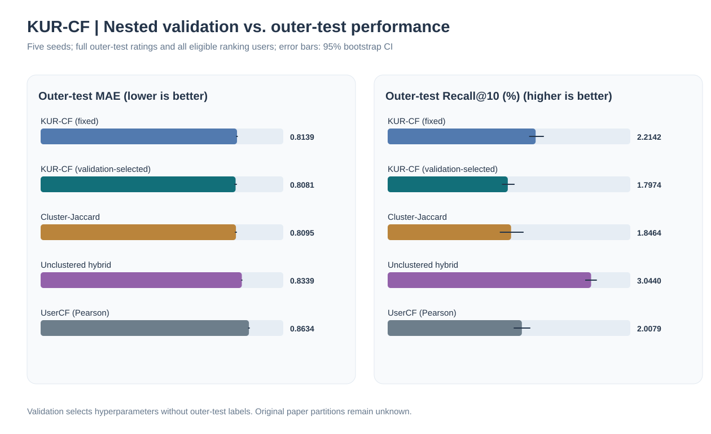

# KURCF-Repro

**基于方差加权 K-means 与共同评分相似度的协同过滤算法——独立复现**

[English README](README.md) · [原论文](https://doi.org/10.1038/s41598-025-96705-0) · [实验原始 JSON](benchmarks/) · [复现差异审计](docs/reproduction-notes.md)

> [!IMPORTANT]
> 本项目不是论文作者的官方实现。下列图表来自 **GitHub Actions 实际运行 MovieLens 100K/1M 的抽样评估**，而非论文原图或论文实验划分。当前结果不能证明论文报告的性能提升已经被严格重复。

## 1. 论文与研究目标

原论文：ShengShai Zhang, Shiping Chen, Xiaodong Yu, Shaowei Mei. *Research on collaborative filtering algorithm based on improved K-means algorithm for user attribute rating and co-rating*. **Scientific Reports**, 15, 19600 (2025). DOI: [10.1038/s41598-025-96705-0](https://doi.org/10.1038/s41598-025-96705-0)。

KUR-CF 将**用户属性评分、方差加权聚类、共同评分混合相似度**串联起来：先依据电影属性构造用户兴趣向量，再用改进 K-means 对用户分簇，最后只在目标用户所属簇中寻找相似邻居并预测评分。复现重点是公式与程序的一一对应，以及明确区分论文内容与独立实现约定。

*图 1. 本项目重绘的算法流程。绿色表示论文给出的运算，橙色表示论文未完整指定、由本项目明确约定的评分预测方法。*

## 2. 核心数学公式

**移动端公式兼容说明：**本节公式已转换为 SVG 矢量图片，原始 LaTeX 保存在 [formulas.json](assets/equations/formulas.json)，通过 [MathJax 生成脚本](scripts/render_equations.cjs) 自动渲染。这样可以避免部分 GitHub 移动客户端直接显示 LaTeX 源码。v0.1.4 同时修正了根式公式（尤其是公式 6）嵌套 SVG 被截断的问题，CI 会检查每张图片的 XML 完整性。

### 2.1 用户属性评分矩阵（论文公式 3）

设用户数为 m、电影数为 p、属性维数为 d。训练集评分矩阵 `X`（m × p），电影属性矩阵 `Y`（p × d，二值矩阵），则

*公式 (3)：用户属性评分矩阵.*

这里的 `Z[u,j]` 是用户 u 对第 j 类属性的**评分总和**，而非均值；缺失评分按零处理。用户历史评分数量不同，可能影响属性向量的尺度。代码位于 `src/kurcf/core.py` 的 `KURCF.fit`。

### 2.2 属性方差及归一化权重（公式 4–5）

*公式 (4)：属性方差.*

*公式 (5)：方差归一化权重.*

属性方差越大，其聚类距离权重越高。所有属性方差均为零时，程序使用均匀权重 `1/d` 作为数值保护措施，这属于**实现约定**。

### 2.3 方差加权 K-means（公式 6–8）

*公式 (6)：加权欧氏距离.*

聚类成员均值与实际样本中心的选择方式为

*公式 (7)：聚类中心选择约定.*

程序默认将均值中心投影至最近的真实样本，采用固定随机种子与最远优先初始化；**论文未完整规定初始化细节**。程序计算聚类分配时使用加权距离的平方，与原距离在最近中心判断上等价。

论文还给出轮廓系数形式：

*公式 (8)：轮廓系数.*

需要注意：`kurcf sweep-k` 使用的是方差缩放空间中的**标准样本轮廓系数**；论文文字涉及样本到聚类中心的距离，不能视为完全相同的实现。

### 2.4 Pearson–Jaccard 混合相似度（公式 9–10）

`I[u]` 和 `I[v]` 分别表示两个用户的已评分电影集合，`I[uv] = I[u] ∩ I[v]`：

*公式 (9)：Jaccard 相似度.*

首先在两个用户共同评分的电影上计算 Pearson 相关系数：

*Pearson 相关系数（基于共同评分项目）。*

再将 Pearson 与 Jaccard 按权重进行组合：

*公式 (10)：混合相似度.*

Pearson 具体采用共同评分项目上的中心化协方差除以标准差乘积；共同评分不足两项或方差为零时，返回零。只保留**同簇且相似度为正**的邻居。

**重要区别：**论文公式 (10) 仅包含 Pearson 与 Jaccard 两项，**没有直接加入 K-means 距离项**。聚类的作用是在计算近邻之前限制候选用户范围。

### 2.5 评分预测（独立实现约定）

论文描述了“从相似用户的已评分电影预测目标用户评分”的过程，但没有给出完整预测方程。本项目采用均值中心化的用户协同过滤：

*本项目实现约定：均值中心化评分预测.*

其中 `N_N(u)` 是用户 u 所属簇中相似度最高的 N 个正相似邻居（实验中 `N = 20`）。若邻居没有给目标电影评分，则回退到训练集电影平均分；没有该电影历史评分时回退到训练集全局平均分。所有统计量均从**训练集**计算，测试集评分不会进入模型拟合。

## 3. 真实数据实验设置

数据来自 [GroupLens MovieLens](https://grouplens.org/datasets/movielens/)，下载后在本地处理，不上传数据集。

| 实验配置 | MovieLens 100K | MovieLens 1M |
|:--|--:|--:|
| 总评分数 | 100,000 | 1,000,209 |
| 训练集评分 | 80,000 | 800,193 |
| 测试集评分 | 20,000 | 200,016 |
| 聚类数 K | 7 | 6 |
| 随机种子 | 42 | 42 |
| 相似邻居数 N | 20 | 20 |
| 混合系数 α | 0.3 | 0.3 |
| 实际用于 MAE/RMSE 的抽样评分数 | **120** | **300** |
| 实际用于 Top-10 的抽样用户数 | **12** | **30** |

使用逐用户随机约 80/20 划分，保证每位用户至少有一条训练评分。对照模型包括：**KUR-CF**（聚类 + 混合相似度）、**UserCF**（不聚类 + Pearson）、**Cluster-Pearson**（相同聚类 + Pearson）。这三种方法使用同一划分与同一抽样评价集。

评价指标为

*公式 (11)–(12)：MAE 与 RMSE.*

*公式 (13)–(14)：Precision@K 与 Recall@K.*

其中 `R_K(u)` 是推荐列表，`T(u)` 为测试集中**评分不低于 4 分**的电影集合，指标采用微平均。MAE/RMSE 越低越好，Precision/Recall 越高越好。

## 4. 算法实际运行结果

下列图表均由仓库内的**真实实验 JSON** 自动绘制，非论文图片、非人工模拟数据。

### 4.1 MovieLens 100K

| 模型 | MAE ↓ | RMSE ↓ | Precision@10 ↑ | Recall@10 ↑ |
|:--|--:|--:|--:|--:|
| **KUR-CF** | **0.86246** | **1.10465** | 0.00833 | 0.01075 |
| UserCF | 0.89891 | 1.15737 | 0.00833 | 0.01075 |
| Cluster-Pearson | 0.89838 | 1.16141 | **0.02500** | **0.03226** |

评价范围：120 条测试评分、12 位用户。推荐命中次数分别为 1、1、3。[实验 JSON](benchmarks/ml100k-smoke.json) · [GitHub Actions 实际运行](https://github.com/ZJY-HSBL/KURCF-Repro/actions/runs/38940035981)。

### 4.2 MovieLens 1M

| 模型 | MAE ↓ | RMSE ↓ | Precision@10 ↑ | Recall@10 ↑ |
|:--|--:|--:|--:|--:|
| **KUR-CF** | **0.76263** | 0.97466 | 0.01667 | 0.00916 |
| UserCF | 0.77581 | **0.96391** | 0.01667 | 0.00916 |
| Cluster-Pearson | 0.77987 | 0.98706 | **0.02667** | **0.01465** |

评价范围：300 条测试评分、30 位用户。推荐命中次数分别为 5、5、8。[实验 JSON](benchmarks/ml1m-smoke.json) · [GitHub Actions 实际运行](https://github.com/ZJY-HSBL/KURCF-Repro/actions/runs/38940286685)。

### 4.3 实验结果解读

当前抽样中，KUR-CF 在两个数据集上的 **MAE 最低**，但 **1M 的 RMSE 不及 UserCF**，两个数据集的 **Precision@10、Recall@10 均不及 Cluster-Pearson**。12/30 位用户的推荐实验样本过小，不能据此断言某一模型在完整数据集上显著优于其他模型。

因此，目前能够确认的是：**算法程序可运行，100K/1M 的真实数据管线已通过验证，并保存了可追溯指标。** 尚不能宣称论文报告的提升幅度已经得到复现。后续仍需多随机种子、完整测试集、置信区间、更多基线和原论文实验协议对齐。

## 5. 安装、运行与重新绘图

要求 Python 3.10+。建议在独立虚拟环境中执行：

~~~bash
git clone https://github.com/ZJY-HSBL/KURCF-Repro.git
cd KURCF-Repro
python -m pip install -e ".[dev]"
pytest -q
kurcf download --dataset ml-100k
kurcf download --dataset ml-1m
~~~

使用与已存档图表相同的抽样配置：

~~~bash
kurcf benchmark --dataset ml-100k --seed 42 --clusters 7 \
  --neighbors 20 --alpha 0.3 --rating-cases 120 \
  --ranking-users 12 --top-k 10 --output results/ml100k.json

kurcf benchmark --dataset ml-1m --seed 42 --clusters 6 \
  --neighbors 20 --alpha 0.3 --rating-cases 300 \
  --ranking-users 30 --top-k 10 --output results/ml1m.json
~~~

探索聚类数：

~~~bash
kurcf sweep-k --dataset ml-100k --min-k 4 --max-k 12 \
  --output results/silhouette.json
~~~

重新生成 README 中的 **3 张实验 SVG 图表**与 **12 张数学公式 SVG**（Node.js 18+）：

~~~bash
node scripts/render_figures.mjs
npm install --no-save --no-package-lock mathjax-full@3.2.2
node scripts/render_equations.cjs
git diff --exit-code -- assets/figures/ assets/equations/*.svg
~~~

实验图表生成脚本读取仓库 `benchmarks/*.json` 中的实验数据；公式渲染脚本读取 `assets/equations/formulas.json` 中的 LaTeX 源码。两类 SVG 均由 CI 校验一致性。新实验的输出默认保存在 `results/`，不会自动篡改原始记录。

## 6. 文件说明与复现边界

| 路径 | 用途 |
|:--|:--|
| `src/kurcf/core.py` | 聚类、相似度、预测和推荐 |
| `src/kurcf/data.py` | MovieLens 下载、加载和数据划分 |
| `src/kurcf/evaluation.py` | 评分误差与 Top-K 指标 |
| `src/kurcf/cli.py` | 命令行入口 |
| `src/kurcf/study.py` | 完整评分实验、消融及参数敏感性分析 |
| `scripts/summarize_study.py` | 多随机种子统计、置信区间和 SVG 生成 |
| `tests/test_study.py` | 消融实验与统计聚合的自动化测试 |
| `tests/test_kurcf.py` | 公式、数据和端到端测试 |
| `benchmarks/*.json` | 100K/1M 实际实验结果 |
| `assets/figures/*.svg` | 算法流程与结果可视化 |
| `assets/equations/*.svg` | 移动端兼容的数学公式矢量图 |
| `assets/equations/formulas.json` | 可编辑的 LaTeX 公式源文件 |
| `scripts/render_figures.mjs` | 根据实验 JSON 重绘 SVG |
| `scripts/render_equations.cjs` | 使用 MathJax 渲染公式 SVG |
| `docs/reproduction-notes.md` | 论文与代码差异、已知局限 |

目前未实现原论文全部对照算法（如 ItemCF、SVD），也没有作者的原始划分与完整预测规则。请勿将独立复现的实验指标误称为论文官方结果。

## 7. 五随机种子完整评分测试与消融实验（v0.2.1）

**真实实验已完成，五组原始 JSON、统计结果和图片均已推送至 GitHub。** MovieLens 100K 采用种子 0–4 的五组独立 80/20 随机划分，每组对**全部 20,000 条测试评分**计算 MAE、RMSE。五组合计 100,000 次预测，但不同划分可能重复出现相同的用户—电影记录。Top-10 推荐指标每组只抽取 **100 位符合条件的用户**，不能称为全量推荐测试。

[完整实验报告](benchmarks/study/README.md) · [原始实验 JSON](benchmarks/study/runs/) · [均值、标准差及 95% 区间](benchmarks/study/ml100k-summary.json) · [GitHub Actions 成功记录](https://github.com/ZJY-HSBL/KURCF-Repro/actions/runs/39006215491) · [实验协议](docs/study-protocol.md)

*图 4. 七种方法的真实测量结果，误差线表示基于随机划分的探索性 95% Bootstrap 区间。*

| 模型 | MAE ↓ | RMSE ↓ | Precision@10 ↑ | Recall@10 ↑ |
|:--|--:|--:|--:|--:|
| **KUR-CF（α=0.3）** | 0.8139 | 1.0457 | 2.20% | 1.93% |
| 传统 UserCF（Pearson） | 0.8633 | 1.0954 | 2.48% | 2.19% |
| 聚类 + Pearson | 0.8336 | 1.0683 | 2.36% | 2.05% |
| **聚类 + Jaccard（α=0）** | **0.8095** | **1.0374** | 1.98% | 1.74% |
| **不聚类 + 混合相似度** | 0.8339 | 1.0693 | **3.24%** | **2.79%** |
| 均匀属性权重 | 0.8157 | 1.0473 | 2.14% | 1.88% |
| 不投影的均值中心 | 0.8131 | 1.0446 | 2.26% | 1.98% |

**关键发现：**KUR-CF 相比传统 UserCF 的平均 MAE 降低 **0.0494**，配对 Bootstrap 95% 区间为 **[0.0456, 0.0535]**。但是，**纯 Jaccard 聚类模型的 MAE、RMSE 比 KUR-CF 更低**；**不聚类的混合相似度模型**反而取得最高的抽样 Precision@10、Recall@10。取消方差权重和取消中心投影造成的 MAE 变化较小，配对区间跨越零，暂时不能认定它们稳定有效。

*图 5. 在测试的 α=0、0.3、0.6、1.0 中，α=0 的 MAE 最低，但提高 α 时抽样召回率有所上升。这只是测试集上的描述性分析，不能据此调参后再报告无偏测试性能。*

*图 6. K=4、7、10 的敏感性比较，不能证明 K=7 在其他数据集上普遍最优。*

这次结果比原来的 100K 小样本测试更可靠，但**仍不等于严格重复原论文的数值结论**：原作者的完整数据划分和预测规则尚不可得；五组划分来自同一数据集；推荐指标仍然只评估抽样用户。

复现单个随机种子，或校验已提交的统计结果：

~~~bash
kurcf download --dataset ml-100k
kurcf study --dataset ml-100k --seed 0 --clusters 7 \
  --neighbors 20 --alpha 0.3 --rating-cases 0 \
  --ranking-users 100 --top-k 10 --output results/seed-0.json

python scripts/summarize_study.py --min-seeds 5 --check
~~~

## 8. 独立验证集调参与全用户推荐测试（v0.3.1）

**五组 MovieLens 100K 真实实验已经完成，全部原始记录、统计报告与 SVG 图已提交。** 不同于 v0.2.1 在测试集上做描述性敏感性分析，这次使用**独立的内部验证集选择 K 和 α**，再用完整外层训练集重新拟合，最后才对外层测试集计算指标。每组对全部 **20,000 条测试评分**进行评价，Top-10 指标覆盖**所有符合条件的 927–935 位用户**，不再只抽取 100 人。

[完整实验报告](benchmarks/nested/README.md) · [五组原始 JSON](benchmarks/nested/runs/) · [统计结果及配对 Bootstrap 区间](benchmarks/nested/ml100k-summary.json) · [GitHub Actions 成功记录](https://github.com/ZJY-HSBL/KURCF-Repro/actions/runs/39017235685) · [实验协议](docs/nested-protocol.md)

*图 7. 五随机种子外层测试集结果。误差线是基于五组随机划分的探索性 95% Bootstrap 区间，并非五个独立数据集的置信区间。*

| 外层测试方法 | MAE ↓ | RMSE ↓ | Precision@10 ↑ | Recall@10 ↑ |
|:--|--:|--:|--:|--:|
| 固定 KUR-CF（K=7，α=0.3） | 0.8139 | 1.0457 | 2.63% | 2.21% |
| **验证集选参 KUR-CF** | **0.8081** | **1.0361** | 2.14% | 1.80% |
| 聚类 Jaccard（K=7） | 0.8095 | 1.0374 | 2.20% | 1.85% |
| **不聚类混合相似度** | 0.8339 | 1.0693 | **3.62%** | **3.04%** |
| 传统 Pearson UserCF | 0.8634 | 1.0955 | 2.39% | 2.01% |

**五组验证集全部选择 K=4、α=0。** 需要注意，这两个参数恰好都是预设网格的最小边界，因此不能说已经找到全局最优参数。

**实验分析：**与固定 KUR-CF 相比，验证集选参后平均 MAE 下降约 **0.0059**，但配对 Bootstrap 95% 区间为 **[-0.0003, 0.0117]**，跨越零，不能据此认定改善稳定显著。与此同时，Recall@10 从 **2.21% 降至 1.80%**；不聚类混合相似度模型则在全体合格用户推荐评价中取得最高的 Precision@10 和 Recall@10。

这直接暴露了研究问题：**评分误差最低的配置，未必具有最好的推荐排序能力。** 下一步应当在独立验证集上扩展 K=2、3 及 α 接近零的候选参数，并考虑单独针对 Top-K 排序指标进行选择，而不是继续只优化 MAE。同时应测量聚类加速带来的收益是否足以抵消召回率下降。

单种子复现实验：

~~~bash
kurcf download --dataset ml-100k
kurcf nested --dataset ml-100k --seed 0 --fixed-clusters 7 \
  --fixed-alpha 0.3 --alpha-grid 0 0.3 0.6 1.0 \
  --cluster-grid 4 7 10 --ranking-users 0 \
  --output results/nested-seed-0.json
~~~

由原始 JSON 重新生成、校验统计表和图片：

~~~bash
python scripts/summarize_nested.py --min-seeds 5
python scripts/summarize_nested.py --min-seeds 5 --check
~~~

本项目仍属于**独立复现**，原论文未公开的完整实验划分和评分预测细节无法据此验证；五组随机划分也不能代表跨数据集的泛化性能。

## 9. 引用与许可证

~~~bibtex
@article{Zhang2025KURCF,
  author  = {Zhang, ShengShai and Chen, Shiping and Yu, Xiaodong and Mei, Shaowei},
  title   = {Research on collaborative filtering algorithm based on improved K-means algorithm for user attribute rating and co-rating},
  journal = {Scientific Reports},
  year    = {2025},
  volume  = {15},
  pages   = {19600},
  doi     = {10.1038/s41598-025-96705-0}
}
~~~

算法思想请引用**原论文**。本项目独立编写的代码采用 [MIT](LICENSE) 许可证，MovieLens 数据及原论文的使用遵循各自权利与许可规定。
