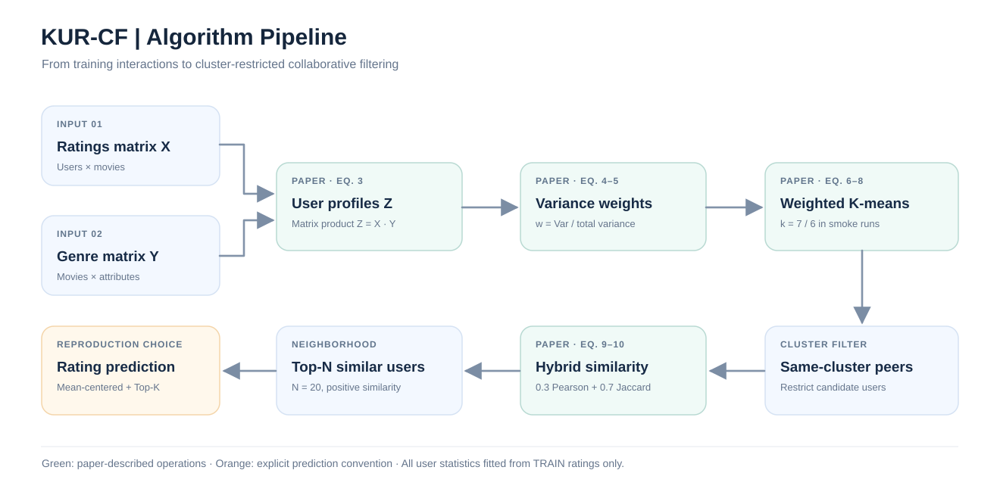
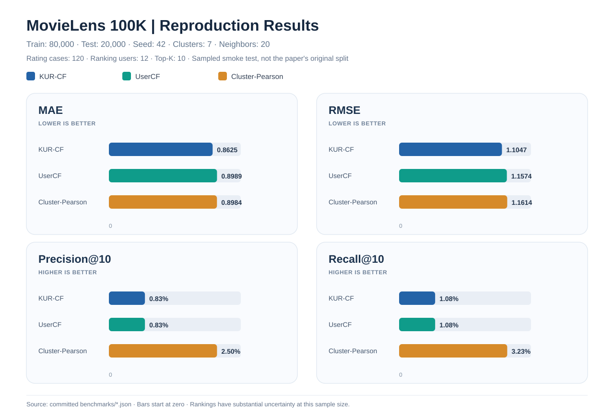
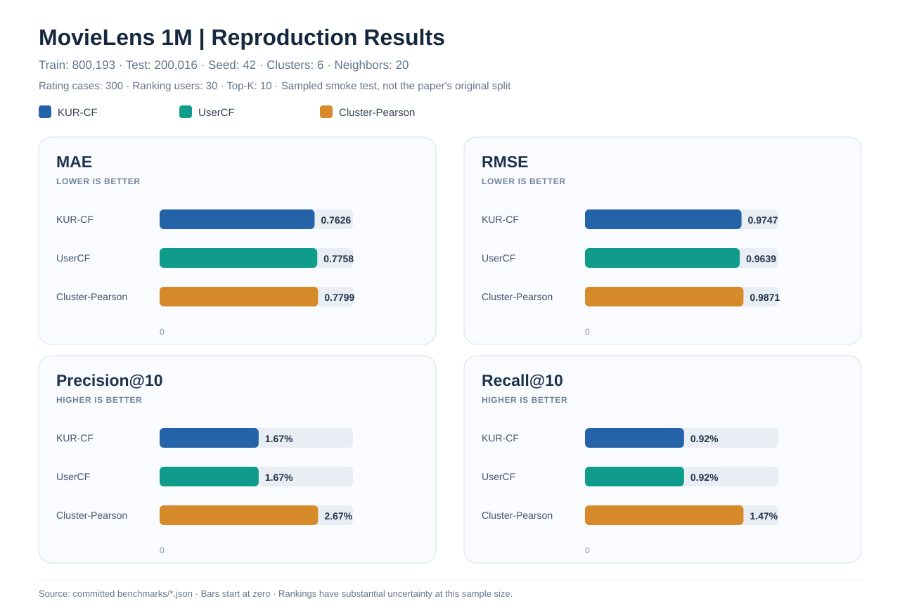

# KURCF-Repro

**基于方差加权 K-means 与共同评分相似度的协同过滤算法——独立复现**

[English README](README.md) · [原论文](https://doi.org/10.1038/s41598-025-96705-0) · [实验原始 JSON](benchmarks/) · [复现差异审计](docs/reproduction-notes.md)

> [!IMPORTANT]
> 本项目不是论文作者的官方实现。下列图表来自 **GitHub Actions 实际运行 MovieLens 100K/1M 的抽样评估**，而非论文原图或论文实验划分。当前结果不能证明论文报告的性能提升已经被严格重复。

## 1. 论文与研究目标

原论文：ShengShai Zhang, Shiping Chen, Xiaodong Yu, Shaowei Mei. *Research on collaborative filtering algorithm based on improved K-means algorithm for user attribute rating and co-rating*. **Scientific Reports**, 15, 19600 (2025). DOI: [10.1038/s41598-025-96705-0](https://doi.org/10.1038/s41598-025-96705-0)。

KUR-CF 将**用户属性评分、方差加权聚类、共同评分混合相似度**串联起来：先依据电影属性构造用户兴趣向量，再用改进 K-means 对用户分簇，最后只在目标用户所属簇中寻找相似邻居并预测评分。复现重点是公式与程序的一一对应，以及明确区分论文内容与独立实现约定。

*图 1. 本项目重绘的算法流程。绿色表示论文给出的运算，橙色表示论文未完整指定、由本项目明确约定的评分预测方法。*

## 2. 核心数学公式

### 2.1 用户属性评分矩阵（论文公式 3）

设用户数为 $m$、电影数为 $p$、属性维数为 $d$。训练集评分矩阵 $X\in\mathbb R^{m\times p}$，电影属性矩阵 $Y\in\{0,1\}^{p\times d}$，则

$$
Z=XY,\qquad Z_{uj}=\sum_{i=1}^{p}X_{ui}Y_{ij}.
\tag{3}
$$

这里的 $Z_{uj}$ 是用户 $u$ 对第 $j$ 类属性的**评分总和**，而非均值；缺失评分按零处理。用户历史评分数量不同，可能影响属性向量的尺度。代码位于 `src/kurcf/core.py` 的 `KURCF.fit`。

### 2.2 属性方差及归一化权重（公式 4–5）

$$
\bar Z_j=\frac1m\sum_{u=1}^{m}Z_{uj},\qquad
\sigma_j^2=\frac1m\sum_{u=1}^{m}(Z_{uj}-\bar Z_j)^2.
\tag{4}
$$

$$
w_j=\frac{\sigma_j^2}{\sum_{\ell=1}^{d}\sigma_\ell^2},\qquad
\sum_{j=1}^{d}w_j=1.
\tag{5}
$$

属性方差越大，其聚类距离权重越高。所有属性方差均为零时，程序使用均匀权重 $1/d$ 作为数值保护措施，这属于**实现约定**。

### 2.3 方差加权 K-means（公式 6–8）

$$
d_w(z_u,c_k)=\sqrt{\sum_{j=1}^{d}w_j(Z_{uj}-c_{kj})^2}.
\tag{6}
$$

聚类成员均值与实际样本中心的选择方式为

$$
\bar c_k=\frac1{|C_k|}\sum_{u\in C_k}z_u,\qquad
c_k=\underset{z_u:\,u\in C_k}{\operatorname{argmin}}\,d_w(z_u,\bar c_k).
\tag{7, 实现}
$$

程序默认将均值中心投影至最近的真实样本，采用固定随机种子与最远优先初始化；**论文未完整规定初始化细节**。程序计算聚类分配时使用加权距离的平方，与原距离在最近中心判断上等价。

论文还给出轮廓系数形式：

$$
s(i)=\frac{b(i)-a(i)}{\max(a(i),b(i))}.
\tag{8}
$$

需要注意：`kurcf sweep-k` 使用的是方差缩放空间中的**标准样本轮廓系数**；论文文字涉及样本到聚类中心的距离，不能视为完全相同的实现。

### 2.4 Pearson–Jaccard 混合相似度（公式 9–10）

$I_u$ 和 $I_v$ 分别表示两个用户的已评分电影集合，$I_{uv}=I_u\cap I_v$：

$$
J(u,v)=\frac{|I_u\cap I_v|}{|I_u\cup I_v|}.
\tag{9}
$$

在共同评分电影上计算 Pearson 相关系数 $P(u,v)$，再进行加权组合：

$$
S(u,v)=\alpha P(u,v)+(1-\alpha)J(u,v),\qquad\alpha=0.3.
\tag{10}
$$

Pearson 具体采用共同评分项目上的中心化协方差除以标准差乘积；共同评分不足两项或方差为零时，返回零。只保留**同簇且相似度为正**的邻居。

**重要区别：**论文公式 (10) 仅包含 Pearson 与 Jaccard 两项，**没有直接加入 K-means 距离项**。聚类的作用是在计算近邻之前限制候选用户范围。

### 2.5 评分预测（独立实现约定）

论文描述了“从相似用户的已评分电影预测目标用户评分”的过程，但没有给出完整预测方程。本项目采用均值中心化的用户协同过滤：

$$
\widehat r_{ui}=
\operatorname{clip}\left(
\bar r_u+
\frac{\sum_{v\in\mathcal N_N(u):\,i\in I_v}S(u,v)(r_{vi}-\bar r_v)}
{\sum_{v\in\mathcal N_N(u):\,i\in I_v}|S(u,v)|},
r_{\min},r_{\max}\right).
\tag{本项目约定}
$$

其中 $\mathcal N_N(u)$ 是用户 $u$ 所属簇中相似度最高的 $N$ 个正相似邻居（实验中 $N=20$）。若邻居没有给目标电影评分，则回退到训练集电影平均分；没有该电影历史评分时回退到训练集全局平均分。所有统计量均从**训练集**计算，测试集评分不会进入模型拟合。

## 3. 真实数据实验设置

数据来自 [GroupLens MovieLens](https://grouplens.org/datasets/movielens/)，下载后在本地处理，不上传数据集。

| 实验配置 | MovieLens 100K | MovieLens 1M |
|:--|--:|--:|
| 总评分数 | 100,000 | 1,000,209 |
| 训练集评分 | 80,000 | 800,193 |
| 测试集评分 | 20,000 | 200,016 |
| 聚类数 K | 7 | 6 |
| 随机种子 | 42 | 42 |
| 相似邻居数 N | 20 | 20 |
| 混合系数 α | 0.3 | 0.3 |
| 实际用于 MAE/RMSE 的抽样评分数 | **120** | **300** |
| 实际用于 Top-10 的抽样用户数 | **12** | **30** |

使用逐用户随机约 80/20 划分，保证每位用户至少有一条训练评分。对照模型包括：**KUR-CF**（聚类 + 混合相似度）、**UserCF**（不聚类 + Pearson）、**Cluster-Pearson**（相同聚类 + Pearson）。这三种方法使用同一划分与同一抽样评价集。

评价指标为

$$
\mathrm{MAE}=\frac1q\sum_{(u,i)}|r_{ui}-\widehat r_{ui}|,\qquad
\mathrm{RMSE}=\sqrt{\frac1q\sum_{(u,i)}(r_{ui}-\widehat r_{ui})^2}.
$$

$$
\mathrm{Precision@K}=\frac{\sum_u|R_K(u)\cap T(u)|}{\sum_u|R_K(u)|},\qquad
\mathrm{Recall@K}=\frac{\sum_u|R_K(u)\cap T(u)|}{\sum_u|T(u)|}.
$$

其中 $R_K(u)$ 是推荐列表，$T(u)$ 为测试集中**评分不低于 4 分**的电影集合，指标采用微平均。MAE/RMSE 越低越好，Precision/Recall 越高越好。

## 4. 算法实际运行结果

下列图表均由仓库内的**真实实验 JSON** 自动绘制，非论文图片、非人工模拟数据。

### 4.1 MovieLens 100K

| 模型 | MAE ↓ | RMSE ↓ | Precision@10 ↑ | Recall@10 ↑ |
|:--|--:|--:|--:|--:|
| **KUR-CF** | **0.86246** | **1.10465** | 0.00833 | 0.01075 |
| UserCF | 0.89891 | 1.15737 | 0.00833 | 0.01075 |
| Cluster-Pearson | 0.89838 | 1.16141 | **0.02500** | **0.03226** |

评价范围：120 条测试评分、12 位用户。推荐命中次数分别为 1、1、3。[实验 JSON](benchmarks/ml100k-smoke.json) · [GitHub Actions 实际运行](https://github.com/ZJY-HSBL/KURCF-Repro/actions/runs/38940035981)。

### 4.2 MovieLens 1M

| 模型 | MAE ↓ | RMSE ↓ | Precision@10 ↑ | Recall@10 ↑ |
|:--|--:|--:|--:|--:|
| **KUR-CF** | **0.76263** | 0.97466 | 0.01667 | 0.00916 |
| UserCF | 0.77581 | **0.96391** | 0.01667 | 0.00916 |
| Cluster-Pearson | 0.77987 | 0.98706 | **0.02667** | **0.01465** |

评价范围：300 条测试评分、30 位用户。推荐命中次数分别为 5、5、8。[实验 JSON](benchmarks/ml1m-smoke.json) · [GitHub Actions 实际运行](https://github.com/ZJY-HSBL/KURCF-Repro/actions/runs/38940286685)。

### 4.3 实验结果解读

当前抽样中，KUR-CF 在两个数据集上的 **MAE 最低**，但 **1M 的 RMSE 不及 UserCF**，两个数据集的 **Precision@10、Recall@10 均不及 Cluster-Pearson**。12/30 位用户的推荐实验样本过小，不能据此断言某一模型在完整数据集上显著优于其他模型。

因此，目前能够确认的是：**算法程序可运行，100K/1M 的真实数据管线已通过验证，并保存了可追溯指标。** 尚不能宣称论文报告的提升幅度已经得到复现。后续仍需多随机种子、完整测试集、置信区间、更多基线和原论文实验协议对齐。

## 5. 安装、运行与重新绘图

要求 Python 3.10+。建议在独立虚拟环境中执行：

~~~bash
git clone https://github.com/ZJY-HSBL/KURCF-Repro.git
cd KURCF-Repro
python -m pip install -e ".[dev]"
pytest -q
kurcf download --dataset ml-100k
kurcf download --dataset ml-1m
~~~

使用与已存档图表相同的抽样配置：

~~~bash
kurcf benchmark --dataset ml-100k --seed 42 --clusters 7 \
  --neighbors 20 --alpha 0.3 --rating-cases 120 \
  --ranking-users 12 --top-k 10 --output results/ml100k.json

kurcf benchmark --dataset ml-1m --seed 42 --clusters 6 \
  --neighbors 20 --alpha 0.3 --rating-cases 300 \
  --ranking-users 30 --top-k 10 --output results/ml1m.json
~~~

探索聚类数：

~~~bash
kurcf sweep-k --dataset ml-100k --min-k 4 --max-k 12 \
  --output results/silhouette.json
~~~

重新生成 README 中的 **3 张 SVG 图片**（Node.js 18+，无需 npm 依赖）：

~~~bash
node scripts/render_figures.mjs
git diff --exit-code -- assets/figures/
~~~

图表生成脚本读取的是仓库 `benchmarks/*.json` 中已存档的实验数据，保证图表与记录一致。新实验的输出默认保存在 `results/`，不会自动篡改原始记录。

## 6. 文件说明与复现边界

| 路径 | 用途 |
|:--|:--|
| `src/kurcf/core.py` | 聚类、相似度、预测和推荐 |
| `src/kurcf/data.py` | MovieLens 下载、加载和数据划分 |
| `src/kurcf/evaluation.py` | 评分误差与 Top-K 指标 |
| `src/kurcf/cli.py` | 命令行入口 |
| `tests/test_kurcf.py` | 公式、数据和端到端测试 |
| `benchmarks/*.json` | 100K/1M 实际实验结果 |
| `assets/figures/*.svg` | 算法流程与结果可视化 |
| `scripts/render_figures.mjs` | 根据 JSON 重绘 SVG |
| `docs/reproduction-notes.md` | 论文与代码差异、已知局限 |

目前未实现原论文全部对照算法（如 ItemCF、SVD），也没有作者的原始划分与完整预测规则。请勿将独立复现的实验指标误称为论文官方结果。

## 7. 引用与许可证

~~~bibtex
@article{Zhang2025KURCF,
  author  = {Zhang, ShengShai and Chen, Shiping and Yu, Xiaodong and Mei, Shaowei},
  title   = {Research on collaborative filtering algorithm based on improved K-means algorithm for user attribute rating and co-rating},
  journal = {Scientific Reports},
  year    = {2025},
  volume  = {15},
  pages   = {19600},
  doi     = {10.1038/s41598-025-96705-0}
}
~~~

算法思想请引用**原论文**。本项目独立编写的代码采用 [MIT](LICENSE) 许可证，MovieLens 数据及原论文的使用遵循各自权利与许可规定。
