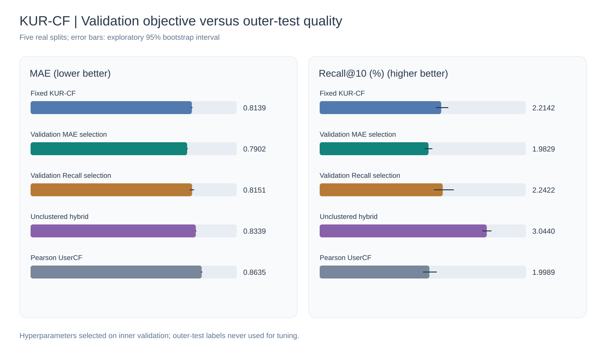

# Multiobjective MovieLens 100K experiment

**Real measurements only.** Both candidate objectives were selected on the
inner validation split. Models were then refit and evaluated on the
same untouched outer test. Validation ranking used a prespecified
sample of 120 eligible users per split;
outer-test ranking evaluated **all eligible users**.

## Outer-test metrics: mean ± sample SD across five splits

| Model | MAE ↓ | RMSE ↓ | Precision@10 (%) ↑ | Recall@10 (%) ↑ |
|:--|--:|--:|--:|--:|
| Fixed KUR-CF | 0.8139 ± 0.0041 | 1.0457 ± 0.0057 | 2.6348 ± 0.1688 | 2.2142 ± 0.1448 |
| Validation MAE selection | 0.7902 ± 0.0039 | 1.0162 ± 0.0054 | 2.3601 ± 0.1190 | 1.9829 ± 0.0932 |
| Validation Recall selection | 0.8151 ± 0.0143 | 1.0467 ± 0.0185 | 2.6689 ± 0.2889 | 2.2422 ± 0.2371 |
| Unclustered hybrid | 0.8339 ± 0.0032 | 1.0693 ± 0.0048 | 3.6226 ± 0.1373 | 3.0440 ± 0.1106 |
| Pearson UserCF | 0.8635 ± 0.0047 | 1.0956 ± 0.0047 | 2.3791 ± 0.1870 | 1.9989 ± 0.1529 |

## Validation-only selections

| Seed | MAE-selected K | MAE-selected alpha | Recall-selected K | Recall-selected alpha | Pareto candidates |
|--:|--:|--:|--:|--:|--:|
| 0 | 2 | 0.10 | 4 | 1.00 | 4 |
| 1 | 2 | 0.05 | 3 | 0.10 | 3 |
| 2 | 2 | 0.10 | 10 | 0.30 | 4 |
| 3 | 3 | 0.10 | 3 | 0.30 | 3 |
| 4 | 2 | 0.05 | 10 | 0.30 | 5 |

## Interpretation constraints

- The validation ranking objective uses a sampled population; test ranking is full-user.
- Candidate grids were prespecified, not tuned using the outer test.
- Five overlapping partitions from one dataset do not imply independent replication.
- Original paper partitions and complete prediction equation remain unavailable.
- [Raw observations](runs/) and [machine-readable summary](ml100k-summary.json).

## Reproducibility

~~~bash
python scripts/summarize_multiobjective.py
python scripts/summarize_multiobjective.py --check
~~~
